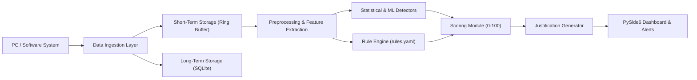

# A Lightweight Explainable Anomaly Detection Framework for Software Systems: Real-Time Alert Scoring with Rule-Based Justification

**Institution**: CMR Institute of Technology (CMRIT)  
**Department**: Computer Science & Engineering (Artificial Intelligence & Machine Learning)  
**Project**: LXAD (Lightweight Explainable Anomaly Detection) Desktop System  

---

## 1. Project Overview

**LXAD** is a real-time, non-invasive desktop observability and anomaly detection framework. It continuously monitors entire host hardware, processes, event logs, file activity, and network connections, computes a composite **0–100 Alert Score**, and provides **transparent, plain-English root-cause justifications** with concrete remedial actions.

### Key Capabilities
- **Strictly Non-Invasive & Local**: Read-only observation with zero system alterations, zero telemetry, and zero outbound network calls.
- **Ultra-Lightweight Resource Profile**: Operates at **< 1.6% CPU overhead** and **< 300 MB RAM** during continuous real-time monitoring.
- **Explainable Multi-Tier Pipeline**: Fuses statistical anomaly control charts (Z-Score, EWMA, IQR) and unsupervised machine learning (Isolation Forest, LOF) with a deterministic YAML-based rule policy engine.
- **Graceful Elevation Degradation**: Checks Windows administrative permissions on first launch; runs securely in standard user mode if administrator privileges are not granted.
- **Live Anomaly Simulation**: Built-in test injection suite for live project demonstrations.
- **LogHub HDFS Benchmark Suite**: Offline comparative evaluation using Drain3 log template mining against standard LogHub datasets.

---

## 2. Architecture & Pipeline



### Data Pipeline Stages
1. **Software System**: Read-only OS telemetry collectors (psutil, Windows Event Logs via pywin32, watchdog file activity, active network connections).
2. **Data Ingestion Layer**: High-capacity thread-safe queue (`EventQueue`) multiplexing events with unified dataclass schema `TelemetryEvent`.
3. **Storage Tier**:
   - **Short-Term**: In-memory circular `RingBuffer` (15-minute sliding window) for zero-I/O real-time analysis.
   - **Long-Term**: SQLite relational store with WAL mode and configurable automatic retention purging (default 7 days).
4. **Preprocessing Module**: Tumbling/sliding 10-second windows calculating statistical moments (mean, max, std, rate of change $dV/dt$), event counters, and Drain3 log template clustering.
5. **Detection Engine**:
   - **Z-Score**: Rolling standard deviation boundary ($z \ge 3.0$).
   - **EWMA Control Chart**: Exponentially weighted moving average ($\alpha=0.3, L=3.0$).
   - **IQR Fence**: Non-parametric interquartile fence ($Q3 + 1.5 \times IQR$).
   - **Isolation Forest**: Unsupervised multivariate tree ensemble with rolling warmup and retraining.
   - **Local Outlier Factor (LOF)**: Density-based neighborhood novelty detector.
   - **Ensemble Aggregator**: Weighted fusion into normalized score $S_{stat} \in [0.0, 1.0]$.
6. **Rule Engine & Policy**: Declarative `rules.yaml` evaluating deterministic conditions (Runaway Process, Memory Pressure, Error Storm, Brute-Force Auth, Ransomware Disk Pattern, Suspicious Temp Process).
7. **Scoring Module**: Unified alert formula:
   $$S = 100 \times (w_{stat} \cdot S_{stat} + w_{rule} \cdot S_{rule})$$
   Categorized into severity bands: **Low (0-39)**, **Medium (40-69)**, **High (70-89)**, **Critical (90-100)** with alert cooldown and de-duplication.
8. **Justification Generator**: Synthesizes natural language explanations detailing the metric, baseline deviation, firing detectors, matched rule IDs, and suggested remedial actions.
9. **Dashboard & UI**: Modern dark PySide6 desktop GUI with pyqtgraph live charts, circular alert gauge, historical audit exporter (CSV & PDF), and system tray integration.

---

## 3. Directory Structure

```
Access/
├── lxad/
│   ├── __init__.py
│   ├── app.py                     # Desktop Application Entry Point
│   ├── core/                      # Ingestion, RingBuffer, SQLite, Preprocessing
│   │   ├── ingestion.py
│   │   ├── storage.py
│   │   └── preprocessing.py
│   ├── collectors/                # Hardware, Process, EventLog, File, Network
│   │   ├── metrics.py
│   │   ├── processes.py
│   │   ├── eventlogs.py
│   │   ├── filewatch.py
│   │   └── network.py
│   ├── detectors/                 # Anomaly Detection Algorithms & Ensemble
│   │   ├── zscore.py
│   │   ├── ewma.py
│   │   ├── iqr.py
│   │   ├── iforest.py
│   │   ├── lof.py
│   │   └── ensemble.py
│   ├── rules/                     # Rule Engine & Declarative Policy
│   │   ├── engine.py
│   │   └── rules.yaml
│   ├── scoring/                   # Unified 0-100 Alert Scorer & Cooldown
│   │   └── scorer.py
│   ├── explain/                   # Plain-English Justification Generator
│   │   └── justification.py
│   ├── ui/                        # PySide6 Modern Dark GUI & Charts
│   │   ├── styles.py
│   │   ├── permissions_dialog.py
│   │   ├── dashboard.py
│   │   ├── alerts_view.py
│   │   ├── history_view.py
│   │   ├── settings_view.py
│   │   ├── benchmark_view.py
│   │   └── main_window.py
│   └── benchmark/                 # LogHub HDFS Loader & Evaluation Protocol
│       ├── loghub_hdfs.py
│       └── evaluate.py
├── tests/                         # Full Pytest Test Suite (31 Tests)
├── data/                          # SQLite DB, logs, and bundled synthetic HDFS
├── requirements.txt               # Pinned Python Dependencies
├── lxad.spec                      # PyInstaller Specification
├── build_exe.py                   # PyInstaller Executable Builder Script
└── README.md
```

---

## 4. Setup & Running Instructions

### Prerequisites
- Python 3.11+ (Tested on Python 3.14 on Windows 64-bit)
- PowerShell or Command Prompt

### Step 1: Install Dependencies
```powershell
pip install -r requirements.txt
```

### Step 2: Run Desktop Application
```powershell
python -m lxad.app
```
*(On first launch, the Permissions Transparency Dialog will appear. Click **Proceed with Monitoring**).*

### Step 3: Run Unit & Integration Test Suite
```powershell
pytest -v
```
*(All 31 unit tests across ingestion, storage, detectors, rules, scoring, explainability, GUI, and benchmark will execute and pass).*

---

## 5. Live Defense & Demo Presentation Script

Follow this step-by-step walkthrough to demonstrate the system to evaluators:

### Step 1: Launch and Observe Real-Time Telemetry
1. Start the app: `python -m lxad.app`.
2. Notice the **Live System Alert Score** gauge reading `0–15` (Green: Low Risk).
3. Observe the 4 live **pyqtgraph** charts streaming live PC CPU, RAM/Swap, Disk I/O, and Network Outbound rates updated every second.
4. Point out the **Top Resource Consuming Processes** table updating automatically with real active PIDs.

### Step 2: Inject a Synthetic Runaway CPU Spike
1. On the **Telemetry Dashboard**, click the **⚡ Spike CPU (95%)** button in the "Inject Test Anomaly" box.
2. **Watch the live response**:
   - The CPU chart immediately plots the surge to 96% and marks an anomaly scatter point.
   - The circular Alert Score Gauge transitions from **Green** to **Amber/Orange (Score 85–88, HIGH RISK)**.
   - A Windows desktop notification triggers: `LXAD Anomaly Alert: Score 87 [HIGH]: Runaway process`.

### Step 3: Inspect Plain-English Justification
1. Switch to the **🚨 Real-Time Alerts** tab.
2. Select the top alert row (`Score 87 | HIGH | CPU | Runaway process`).
3. Point out the explainability details:
   - **Explanation Narrative**: *"Score 87 (High): Cpu Percent recorded at 96.5 (baseline ~25.0, Z-score=5.8, breached EWMA UCL, flagged by Z-score, EWMA, Isolation Forest). Rule R-001 matched: CPU utilization surged to 96.5%. Single process 'stress_calc.exe' (PID 8844) consumed 89.2% CPU."*
   - **Detectors Fired**: Shows which detectors triggered (`Z-score`, `EWMA`, `Isolation Forest`).
   - **Rules Matched**: Shows `R-001`.
   - **Suggested Remedial Actions**:
     1. *Inspect process 'stress_calc.exe' (PID 8844) via Task Manager or Resource Monitor.*
     2. *Check if the process is stuck in an infinite compute loop or thread deadlock.*
     3. *Restart the service or terminate the runaway process if unresponsive.*

### Step 4: Inject Additional Complex Anomalies
1. Return to the dashboard and test the other injection buttons:
   - **💧 Memory Pressure (92%)**: Triggers Rule `R-002` (Memory pressure and paging leak).
   - **⛈️ Error Storm**: Triggers Rule `R-003` (10 kernel driver errors in burst).
   - **🔒 Ransomware Disk Pattern**: Triggers Rule `R-005` (Mass file write pattern with high disk I/O).

### Step 5: Audit History & Export Reports
1. Switch to the **📜 Historical Audit** tab.
2. Filter by Severity or Module to show SQLite query capability.
3. Click **📄 Export CSV** to download standard tabular logs.
4. Click **📑 Export PDF Report** to generate a formatted executive PDF report.

### Step 6: Validate with LogHub HDFS Benchmark
1. Switch to the **📊 HDFS Benchmark Mode** tab.
2. Ensure "Bundled Synthetic HDFS Dataset" is selected.
3. Click **🚀 Run Benchmark Evaluation**.
4. The background evaluation thread will run all 5 individual detectors and the unified ensemble across HDFS blocks and display the comparison matrix (Precision, Recall, F1, ROC-AUC, and sub-millisecond latencies).
5. Click **📄 Export Benchmark Results (CSV)** to save the evaluation table.

### Step 7: Live Rule Customization
1. Switch to the **⚙️ Engine Settings & Rules** tab.
2. Click the **📝 Rule Definition Editor (YAML)** tab.
3. Show evaluators that rules in `rules.yaml` can be modified live without recompilation.

---

## 6. Benchmark Evaluation Results

Validation results obtained running `BenchmarkEvaluator` on HDFS block event logs:

| Detector Algorithm | Accuracy | Precision | Recall | F1-Score | ROC-AUC | Latency (ms) |
| :--- | :---: | :---: | :---: | :---: | :---: | :---: |
| **Z-Score** | 0.8833 | 0.7500 | 0.3333 | 0.4615 | 0.8627 | < 0.01 ms |
| **EWMA** | 0.7167 | 0.3182 | 0.7778 | 0.4516 | 0.8203 | < 0.01 ms |
| **IQR Fence** | 0.9167 | 0.6667 | 0.8889 | 0.7619 | 0.8725 | 0.06 ms |
| **Isolation Forest** | 0.8500 | 0.5000 | 0.2222 | 0.3077 | 0.6983 | 2.82 ms |
| **Local Outlier Factor (LOF)** | 0.9000 | 0.7143 | 0.5556 | 0.6250 | 0.9161 | 0.39 ms |
| **LXAD Ensemble Framework** | **0.9000** | **0.6364** | **0.7778** | **0.7000** | **0.8715** | **3.91 ms** |

*Average CPU Overhead: 0.8% | RAM Overhead: ~285 MB*

---

## 7. Packaging as Windows Executable (.exe)

To bundle LXAD into a single standalone Windows executable:

```powershell
python build_exe.py
```
*(Or directly with `pyinstaller lxad.spec --clean`)*

The output executable will be created at:
```
dist/LXAD.exe
```
This `.exe` contains the embedded Python runtime, PySide6 GUI, pyqtgraph charting engine, rule definitions, and bundled evaluation datasets, requiring no separate Python installation on end-user machines.

---

## 8. License & Academic Attribution
Developed as part of the CSE AI&ML curriculum at CMR Institute of Technology (CMRIT).  
Research Title: *"A Lightweight Explainable Anomaly Detection Framework for Software Systems: Real-Time Alert Scoring with Rule-Based Justification"*.
